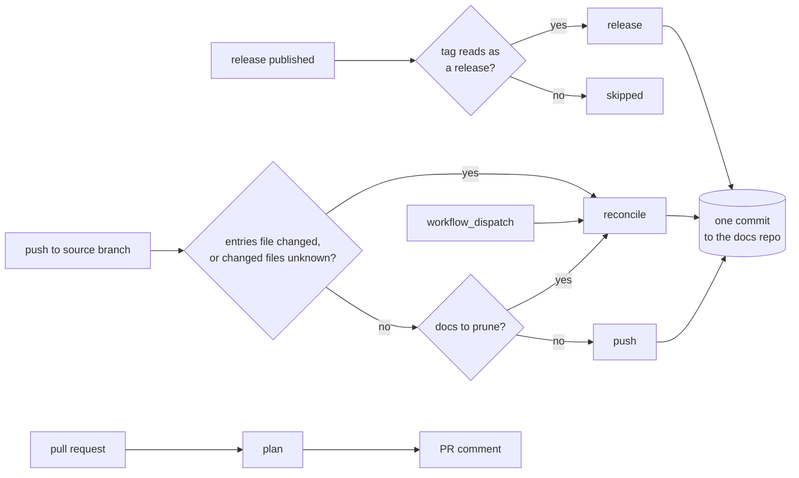

# Docs publisher

A GitHub Action that publishes a source repo's docs into the docs repo: the one central repository where the documentation of many repositories is gathered. Releases write versioned docs, pushes refresh the docs that follow the source branch, and pull requests get a comment that plans the changes without writing anything. Nothing is installed in the docs repo.

The terms used here (Area, Version folder, Mirror Area…) are defined in [GLOSSARY.md](./GLOSSARY.md).

## Usage

```yaml
on:
  release: { types: [published] }
  push: { branches: [main] }
  pull_request: { branches: [main] }
  workflow_dispatch:

permissions:
  contents: read
  pull-requests: write

jobs:
  publish:
    runs-on: ubuntu-latest
    steps:
      - uses: actions/checkout@v7
        with:
          fetch-depth: 0                 # the publisher reads tags and history
          persist-credentials: false
          ref: ${{ github.event.pull_request.head.sha }}   # empty outside pull requests
      - id: token
        uses: actions/create-github-app-token@v3
        with:
          client-id: ${{ vars.DOCS_APP_CLIENT_ID }}
          private-key: ${{ secrets.DOCS_APP_KEY }}
          owner: my-org
          repositories: docs
          permission-contents: ${{ github.event_name == 'pull_request' && 'read' || 'write' }}
      - uses: prefapp/action-docs-publisher@v1
        with:
          docs-repository: my-org/docs
          docs-root-folder: site/raw
          docs-token: ${{ steps.token.outputs.token }}
          github-token: ${{ github.token }}
```

Do not check out the docs repo: the action clones it itself, outside the workspace. Pull requests from forks get no secrets, so skip the job for them. To avoid racing pushes to the docs branch, add a `concurrency` group to the workflow.

| Input | Required | Default | Description |
| --- | --- | --- | --- |
| `docs-repository` | yes | | The docs repo, as `org/repo`. |
| `docs-root-folder` | yes | | The folder of the docs repo the Areas live under, such as `site/raw`, or `.` for the top of the docs repo, where the Areas sit next to its own files (see [Using `.` as the root](#using--as-the-root)). Only `.` itself is accepted; `./`, `./x`, `x/` and `x/.` are refused. |
| `docs-branch` | no | `main` | The docs repo branch to publish to. It must exist, and it must be a valid git branch name. |
| `source-branch` | no | `main` | The branch whose pushes refresh mirrors and Branch Version folders. It must be a valid git branch name; an entry that publishes it as a Branch Version folder needs a name without `/`. |
| `entries-file` | no | `.github/docs_publisher.yaml` | The entries file, relative to the checkout. It must resolve inside the checkout: a path that climbs out, and a symlink that points outside it, are refused. |
| `docs-token` | yes | | A token that can push to the docs repo. Commits are authored by its account. |
| `github-token` | yes | | A token for this repo, used to fetch it and to comment the plan. |

| Output | Description |
| --- | --- |
| `run-mode` | What the run did: `release`, `push`, `reconcile`, `plan` or `skipped`. |
| `docs-changed` | `"true"` when the run pushed a commit to the docs repo. A plan never pushes. |
| `docs-commit-sha` | The commit pushed to the docs repo, when there is one. |

### Using `.` as the root

With `docs-root-folder: .`, the Areas sit at the top of the docs repo (`features/`, `core/docs/`), next to the docs repo's own files. Only `.` itself is accepted: `./`, `./x`, `x/` and `x/.` are refused. The trade-offs:

- **A folder the docs repo already has is never taken over.** If the Area folder exists and holds no `.meta.json` anywhere, the run fails, names the folder and the first files it would delete, and changes nothing. The same holds for the Branch Version folder inside a release Area: a run replaces it whole, so a folder with no marker of its own is refused, not replaced. This is the same at any root. Move or delete the hand-made files first to use the folder as an Area, or pick another `area` name; avoid `.github`. A folder that holds a `.meta.json` belongs to the source repo the marker names, and the usual ownership rules apply.
- **Every source repo shares the top level.** Their Areas mix with the docs repo's README, site config and CI files, and nothing keeps a later Area name from colliding with a folder added to the docs repo afterwards.
- **Moving away later is manual.** Changing `docs-root-folder` only moves future writes. Clearing the old Areas means deleting them one by one among the docs repo's own files.

A subfolder such as `site/raw` avoids the sharing and the manual move: the publisher never writes outside it.

## How a run flows

The event picks the run mode. Nothing else does: there are no flags.



| Run mode | Writes |
| --- | --- |
| `release` | The Version folder of every release entry that matches the tag, then the Area's shared files. A tag whose Version folder exists writes nothing. |
| `push` | Each Mirror Area and Branch Version folder whose files changed, and the shared files of release Areas that have `areaFiles`, writing only what differs. Never a Version folder, never a prune. |
| `reconcile` | Everything needed to match the entries file and the tags: missing versions, versions whose spec changed, mirrors, Branch Version folders, shared files, prune. |
| `plan` | Nothing. It comments what a reconcile of the pull request's head would do. |
| `skipped` | Nothing. The summary names the tag. |

A push that has docs to prune runs a reconcile and reports `run-mode: reconcile`. When the docs repo rejects the push, the run fetches, plans again and retries, up to 5 attempts.

## The entries file

A list of entries. Each entry has an `area` (a folder under `docs-root-folder`), an entry mode (`release` or `mirror`) and collect rules. The file is always read from `source-branch`, so an edit applies from the next run.

Release with packages: one Version folder per package and tag (`state_repo-v1.2.0` → `features/state_repo/1.2.0/`).

```yaml
- area: features
  mode: release
  packages: packages            # one package per subfolder
  publishSourceBranch: true     # also features/<name>/main/
  areaFiles:
    - { from: README.md, to: README.md }
  collect:
    - { from: "templates/docs/*", to: . }
```

Release without packages: one Version folder per tag (`v1.2.0` → `core/crds/v1.2.0/`).

```yaml
- area: core/crds
  mode: release
  collect:
    - { from: "docs/crds/**", to: . }
```

Mirror: a copy of the source branch's current docs, replaced whole on each relevant push.

```yaml
- area: core/docs
  mode: mirror
  collect:
    - { from: "docs/**", to: . }
```

| Key | Entry mode | Description |
| --- | --- | --- |
| `area` | both | Required. The folder to publish into. |
| `mode` | both | Required. `release` or `mirror`. |
| `collect` | both | Required. `{from, to}` rules. A literal `from` copies one file; `*`, `**` or `?` copy every match into the `to` folder. With `packages`, `from` is read from the package folder. |
| `build` | both | A shell command run before collecting, in the same folder. It gets no token. |
| `paths` | mirror | The files whose changes trigger the mirror. Default: the `from` values. Required with `build`. |
| `packages` | release | The folder holding one subfolder per package. |
| `tagNames` | release | A release-please config whose `component` / `package-name` maps tag names to package folders. Needs `packages`. |
| `mainFile` | release | The file each version links to in the Area's version list, [`versions.json`](#docs-repo-layout). Default `README.md`. |
| `prereleases` | release | `true` to publish prerelease tags. Default `false`. |
| `areaFiles` | release | Single files placed at the top of the Area. |
| `publishSourceBranch` | release | `true` to also publish the tip of `source-branch` as a Branch Version folder. Default `false`. |

Tags a release entry publishes:

| Entry | Tag | Version folder |
| --- | --- | --- |
| with `packages` | `<name>-v<semver>`, `<name>` = package folder (or its `tagNames` name) | `<area>/<name>/<semver>/` |
| without `packages` | `v<semver>` | `<area>/v<semver>/` |

An unknown key, two entries with one Area, a release Area inside another Area, or a path that leaves the repo fails the run before anything is written. The error names the entry.

## Docs repo layout

The examples above produce this tree under `docs-root-folder`:

```
site/raw/
├── features/                    release Area
│   ├── index.json               shared: packages and their latest version
│   ├── README.md                shared: Area file
│   └── state_repo/
│       ├── versions.json        shared: every version, newest first
│       ├── README.md …          shared: Latest copy of 1.2.0
│       ├── 1.2.0/               Version folder                                 (release, reconcile)
│       │   └── .meta.json       Version marker
│       ├── 1.1.0/
│       └── main/                Branch Version folder                          (push, reconcile)
│           └── .meta.json       Branch Version marker
└── core/
    ├── crds/                    release Area without packages
    │   ├── versions.json
    │   ├── latest/              Latest copy
    │   └── v1.2.0/
    └── docs/                    Mirror Area, replaced whole                    (push, reconcile)
        └── .meta.json           Mirror marker
```

A release Area also gets shared files, which a docs site reads instead of walking the folders:

- `versions.json`: every version, newest first, with its date and a link to its `mainFile`. One per package, or one per Area without `packages`. A site uses it for a version picker.
- `index.json`: every package with a stable version, its latest version and links to its Markdown files. Only for Areas with `packages`.
- Latest copy: the files of the latest version at a fixed path, so links to it don't change between releases.
- Area files: the files listed in `areaFiles`.

Shared files are rebuilt from the Version folders by every release and reconcile, and by a push when the Area has `areaFiles`, so the result never depends on the order of releases. Latest is the highest stable version: a prerelease or a backport never replaces it.

## Metadata files

A `.meta.json` marks every folder the publisher owns. A run only touches or deletes folders whose marker names its own repo as `source`, and the first repo to publish into an Area owns it.

| Marker | Where | Fields |
| --- | --- | --- |
| Version marker | each Version folder | `source`, `tag`, `date`, `specHash` |
| Mirror marker | root of each Mirror Area | `source`, `sourceRevision`, `sourceBranch`, `date` |
| Branch Version marker | each Branch Version folder | `source`, `area`, `branch`, `sourceRevision`, `date` |

```json
{ "source": "my-org/features", "tag": "state_repo-v1.2.0", "date": "2025-03-04T10:15:00Z", "specHash": "4f65…" }
```

`specHash` hashes the entry's `collect`, `build` and `packages`. A reconcile republishes a version from its tag when the hash differs from the current entry. A marker with a missing or invalid field is damaged: the run stops with `invalid .meta.json: <path>`.

## Manual run

Run the workflow by hand (Actions, Run workflow). It is a reconcile on `source-branch`. Use it after installing on a repo that already has tags, and to repair hand edits in the docs repo. Running it again when everything is in place changes nothing. A tag whose content no longer fits its entry is skipped and listed in the run summary; the other versions are still published.

### Changing the destination

`docs-repository`, `docs-root-folder` and `docs-branch` name where future runs write.

1. Change the input in the workflow.
2. Let the next release or push publish there. It publishes no Version folder, and only the Branch Version folders of the release Areas whose files it changed. The rest — every Version folder, the other Branch Version folders and the links of an Area without `areaFiles` — comes from step 3, so run it.
3. Run the workflow by hand (Actions, Run workflow), a reconcile on `source-branch`.

Delete the Areas in the old destination by hand once the new one is complete.

## Pull request plan

A pull request that changes the entries file, or a file in a release entry's `packages` folder, gets one comment, updated on every push. The comment lists, per Area, what the merge would add, republish, refresh, delete or replace, plus the problems that would make it fail. The plan writes nothing to the docs repo. A pull request that stops changing those files gets its comment replaced with `This pull request no longer changes docs publishing.`

## Removing docs (prune)

Every reconcile deletes the docs whose source is gone. A plan lists these deletions before the merge.

| You remove | The run deletes |
| --- | --- |
| an entry (or rename its `area`) | the whole Area |
| a package folder | `<area>/<name>/`, and its row in `index.json` |
| `publishSourceBranch` | the Branch Version folder |
| a change of entry mode | the Area, then publishes it again in the new mode |

A Version folder with no tag left can only be restored from the docs repo's git history; the run summary warns about it. Prune refuses to run when a `packages` folder is missing from the checkout, or when `source-branch` moved past the checkout; the next run prunes.

## Troubleshooting

A failing run fails the job with `::error::docs_publisher: <message>`, and the same message is added to the run summary. A plan that finds problems still succeeds: its comment lists them.

| Message or symptom | Cause | Fix |
| --- | --- | --- |
| `Area "core/crds" belongs to other/producer, but this repo is acme/source. Choose another Area. If this repo was renamed or is taking over the Area, update "source" in that Area's .meta.json files in the docs repo.` | Another repo owns the Area. | Choose another Area, or update `source` in its `.meta.json` files after a rename or handover. |
| `refusing to publish <folder>: the folder holds no .meta.json, so it is not an Area this repo published, and this run would delete …` | A folder the docs repo already has sits where the run would publish an Area, or where a release entry's Branch Version folder would be. Replacing it would delete its files. | Move or delete the hand-made files, then run again; or choose another `area`. |
| `entries-file must be a relative path inside the source checkout: "<path>"` | The input is absolute, climbs out of the checkout, or is a symlink that points outside it. | Name a file inside the checkout. |
| `docs-branch "<name>" is not a valid git branch name`, or the same for `source-branch` | The input is not a name git accepts: `..`, a space, a leading `-` and names ending in `.lock` are refused. | Use the branch's own name. A `source-branch` that a release entry publishes as a Branch Version folder must also be one folder name, so it cannot contain `/`. |
| `invalid .meta.json: <path>` | A marker is damaged or misplaced. | Fix or delete the marker by hand, then run a manual run. |
| A run stops on a folder named like a version with no `.meta.json` | Docs written before the publisher. | Add a Version marker to folders that have no tag; delete the others so the publisher republishes them. |
| `could not fetch the docs branch "<branch>" from origin` | `docs-branch` does not exist. | Create it in the docs repo first. |
| `refusing to write through symlink: <path>` | A symlink in a folder the run would write or delete. | Remove the symlink from the docs repo. |
| `push failed after 5 attempts` | Other runs kept pushing to the docs branch. | Run again. |
| A tag cut before installing published nothing | A release runs from the tagged commit. | Run a manual run. |
| Changing `docs-repository`, `docs-root-folder` or `docs-branch` | Only future runs write to the new place. | Run a manual run to fill it, then delete the old Areas by hand. |
